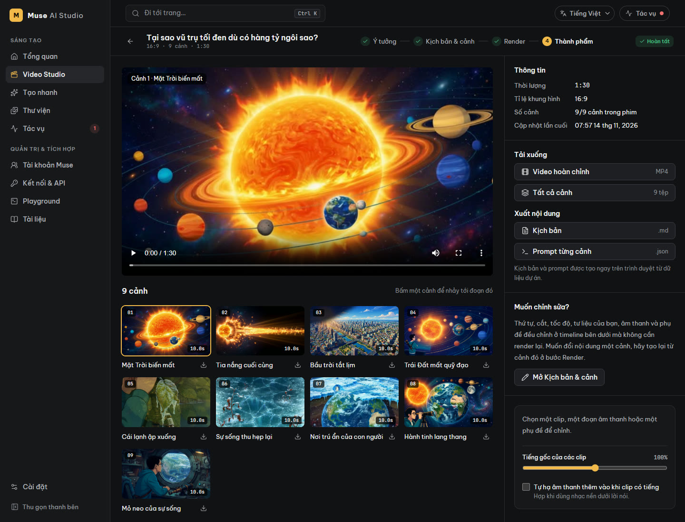
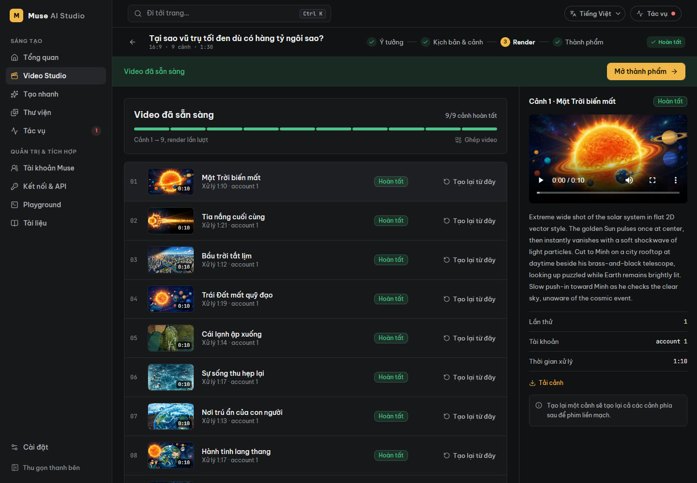
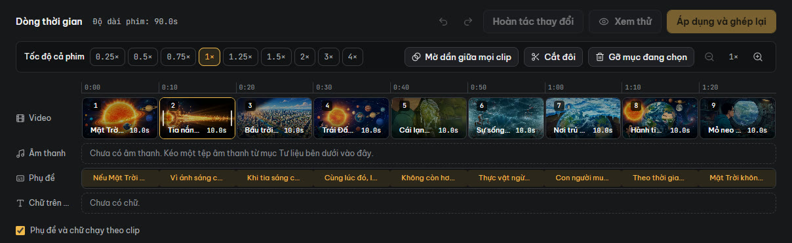
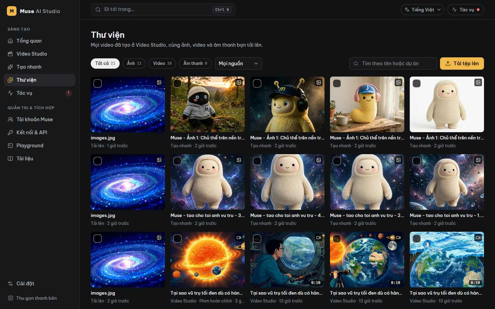
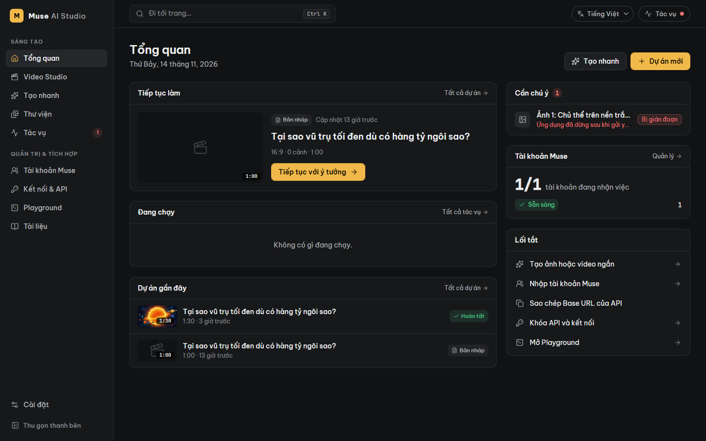
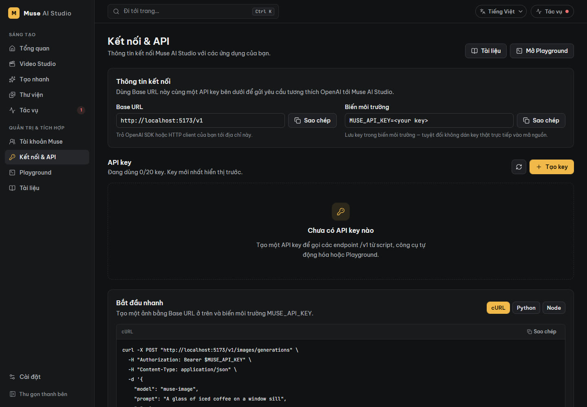

# Muse AI Studio

**Biến một ý tưởng thành phim AI hoàn chỉnh, ngay trên máy của bạn.**

Muse AI Studio là xưởng làm video tự cài (self-hosted) chạy bằng tài khoản [Muse](https://muse.ai) của chính bạn. Bạn đưa ý tưởng; ứng dụng viết kịch bản, dựng từng cảnh, ghép thành phim, rồi để bạn cắt ghép, thêm nhạc và phụ đề trong trình duyệt. Không cần phần mềm dựng phim, không cần tải lên dịch vụ nào khác.



## Vì sao dùng

- **Một mạch từ ý tưởng tới phim.** Không phải chép prompt qua lại giữa các công cụ: ý tưởng → kịch bản → cảnh → phim nằm trong một dự án.
- **Bạn giữ quyền quyết định.** Kịch bản do AI viết nhưng bạn duyệt và sửa từng cảnh trước khi tốn quota dựng.
- **Sửa phim không cần dựng lại.** Đổi thứ tự, cắt, thêm nhạc hay phụ đề chỉ ghép lại từ các cảnh đã có.
- **Dữ liệu ở máy bạn.** Phim, ảnh, kịch bản và phiên đăng nhập (được mã hoá) đều nằm trong một thư mục trên máy.
- **Mở cho ứng dụng khác.** Có API chuẩn OpenAI để gọi từ script hay công cụ tự động hoá.

## Từ ý tưởng tới phim

Mỗi dự án đi qua bốn bước: **Ý tưởng → Kịch bản & cảnh → Render → Thành phẩm**.

1. **Ý tưởng.** Tên, câu chuyện, thời lượng (tới 60 phút), tỉ lệ khung hình, phong cách hình ảnh, ngôn ngữ; có thể đính kèm ảnh/video tham chiếu.
2. **Kịch bản & cảnh.** Muse chia câu chuyện thành các cảnh 5–10 giây kèm lời dẫn. Bạn sửa, thêm, bớt, sắp lại tuỳ ý.
3. **Render.** Mỗi cảnh được dựng thành một video; các cảnh có thể nối liền mạch với nhau. Cảnh nào chưa ưng thì tạo lại từ cảnh đó.
4. **Thành phẩm.** Phim được ghép tự động và mở ra trong trình biên tập.



## Trình biên tập ngay trong trình duyệt



- Kéo thả để sắp xếp, kéo mép để cắt, tách đôi clip, đổi tốc độ từng clip hoặc cả phim.
- Hiệu ứng màu, phóng chậm, lật hình, mờ dần giữa các clip.
- Chèn video, ảnh, âm thanh của bạn; nhờ Muse tạo nhạc nền; tự hạ nhạc khi có tiếng.
- Phụ đề (tạo sẵn từ lời dẫn), tiêu đề và logo; xuất kèm tệp `.srt`.
- Chọn tỉ lệ, độ phân giải, chất lượng khi xuất; chọn ảnh bìa.
- Xem thử trước khi ghép, hoàn tác/làm lại, bản nháp được giữ khi lỡ rời trang.

## Tạo nhanh và Thư viện

Cần một tấm ảnh hay một video ngắn mà không muốn lập dự án? **Tạo nhanh** nhận một câu mô tả (kèm ảnh tham chiếu nếu muốn) và trả kết quả vào **Thư viện**, nơi gom mọi video, ảnh, âm thanh đã tạo hoặc tải lên. Tư liệu trong thư viện dùng lại được cho mọi dự án.



## Luôn biết mọi thứ đang ở đâu

Trang **Tổng quan** cho thấy dự án đang làm dở, tác vụ đang chạy, việc cần bạn xử lý và tình trạng các tài khoản Muse. Trang **Tác vụ** theo dõi từng việc chạy nền: huỷ, thử lại hoặc xoá.



## Dùng nhiều tài khoản Muse

Nhập một hay nhiều tài khoản bằng phiên đăng nhập từ trình duyệt (trong ứng dụng có hướng dẫn từng bước). Ứng dụng tự chia việc giữa các tài khoản, giữ phiên sống, theo dõi quota và hỗ trợ proxy riêng cho từng tài khoản.

## API cho ứng dụng của bạn

Muse AI Studio nói chuyện theo chuẩn OpenAI: dùng SDK OpenAI sẵn có, chỉ đổi Base URL và khoá. Tạo khoá ở trang **Kết nối & API**, thử ngay ở **Playground**, tra cứu ở **Tài liệu**.



```python
import os
from openai import OpenAI

client = OpenAI(base_url="http://localhost:5173/v1", api_key=os.environ["MUSE_API_KEY"])
image = client.images.generate(model="muse-image", prompt="Ly cà phê sữa đá trên bậu cửa sổ, nắng sớm")
print(image.data[0].url)
```

## Bắt đầu

Cần có Python 3.12+ với [uv](https://docs.astral.sh/uv/getting-started/installation/), Node.js 22.12+, FFmpeg, Chrome (hoặc Chromium/Edge) và một tài khoản Muse.

```bash
# Cửa sổ 1: máy chủ
cd backend
uv sync --locked
uv run uvicorn app.main:app --host 127.0.0.1 --port 18610

# Cửa sổ 2: giao diện
cd frontend
npm ci
npm run dev
```

Mở `http://localhost:5173`, rồi:

1. Vào **Tài khoản Muse** → **Hướng dẫn lấy token**, làm theo để lấy phiên đăng nhập.
2. Bấm **Nhập tài khoản**, dán vào, rồi bấm **Kiểm tra**.
3. Vào **Video Studio** tạo dự án đầu tiên, hoặc **Tạo nhanh** để thử một tấm ảnh.

Trang **Cài đặt** cho biết ứng dụng đã tìm thấy FFmpeg và trình duyệt chưa. Giao diện có tiếng Việt và tiếng Anh.

Cấu hình, sao lưu dữ liệu và chi tiết kỹ thuật: xem [backend/README.md](backend/README.md) và [frontend/README.md](frontend/README.md).

## Cần biết trước khi dùng

- Đây **không phải** sản phẩm chính thức của Muse. Ứng dụng điều khiển giao diện web của Muse bằng phiên đăng nhập của bạn; mỗi lượt tạo dùng quota của tài khoản bạn và phải tuân theo điều khoản của Muse. Khi Muse đổi giao diện, việc tạo nội dung có thể tạm hỏng.
- Ứng dụng **không có đăng nhập**: ai mở được địa chỉ của nó cũng dùng được mọi thứ. Chỉ chạy trên máy cá nhân hoặc mạng bạn tin cậy.
- Phim dài tốn nhiều quota và thời gian: mỗi cảnh là một lượt tạo trên Muse.

## Giấy phép

[MIT](LICENSE)
