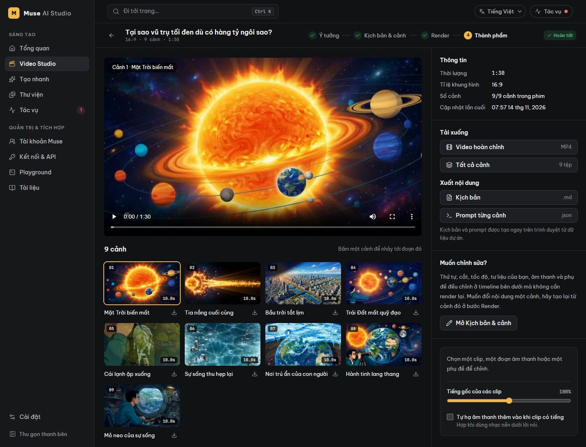
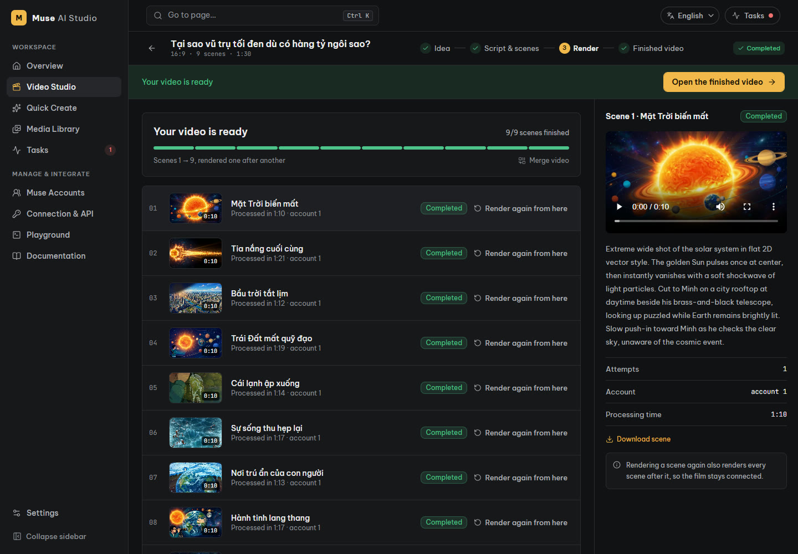
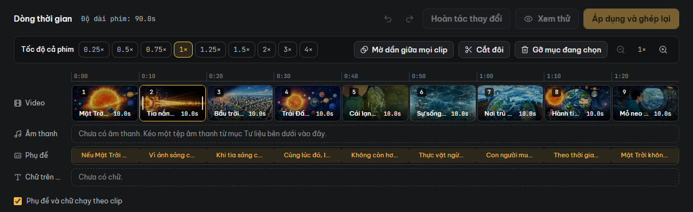
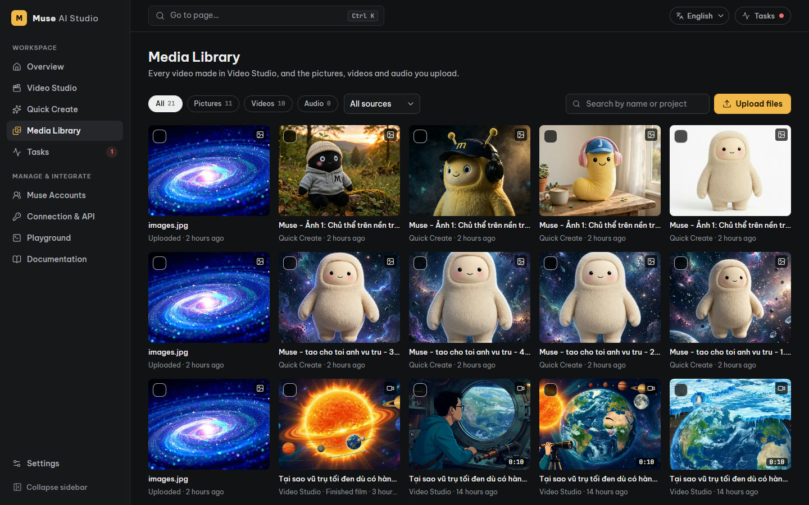
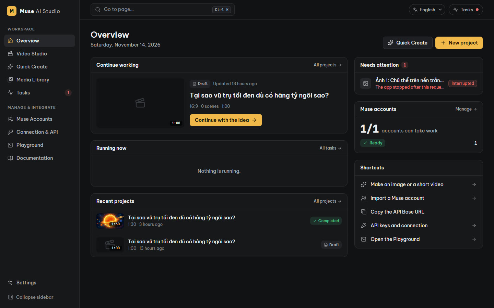
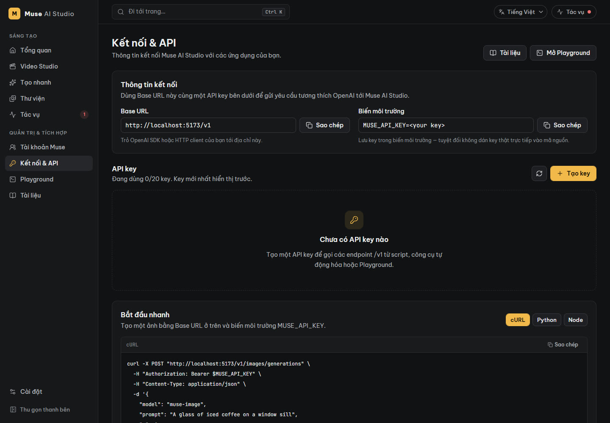

# Muse AI Studio: open-source AI video generator

**Turn an idea into a finished AI film, on your own machine.**

[](LICENSE)


Muse AI Studio is a free, self-hosted **AI video generator** that runs on your own [Muse](https://muse.ai) account. You bring the idea; the app writes the script, turns each scene into a video (text-to-video), merges them into a film, and lets you cut, add music and add captions in a browser timeline editor. It also makes quick AI pictures and short videos, and answers an **OpenAI-compatible API**. No editing software to install, nothing to upload to another service. [Tiếng Việt](#tiếng-việt) · [Install](#getting-started) · [FAQ](#faq)



## Tiếng Việt

**Muse AI Studio** là phần mềm **tạo video AI** mã nguồn mở, cài và chạy ngay trên máy bạn bằng tài khoản Muse của chính bạn. Bạn chỉ cần nhập ý tưởng, app tự viết kịch bản, tạo video cho từng cảnh rồi ghép thành phim hoàn chỉnh. Sau đó bạn cắt ghép, thêm nhạc, phụ đề và tiêu đề ngay trên trình duyệt. Ngoài ra app tạo nhanh ảnh và video ngắn bằng AI, và có API tương thích OpenAI. Giao diện có tiếng Việt. Cài bằng một lệnh trên Windows, macOS và Linux: xem [hướng dẫn cài đặt](INSTALL.vi.md).

## Why use it

- **One path from idea to film.** No copying prompts between tools: idea → script → scenes → film all live in one project.
- **You stay in charge.** The AI writes the script, but you review and edit every scene before any quota is spent on rendering.
- **Edit without rendering again.** Reordering, trimming, adding music or captions only merges the scenes you already have.
- **Your data stays with you.** Films, pictures, scripts and your (encrypted) sign-in session all sit in one folder on your machine.
- **Open to other apps.** An OpenAI-compatible API lets scripts and automation tools generate through it.

## From idea to film

Every project goes through four steps: **Idea → Script & scenes → Render → Finished video**.

1. **Idea.** A name, the story, the length (up to 60 minutes), the aspect ratio, the visual look and the language; you can attach reference pictures or videos.
2. **Script & scenes.** Muse splits the story into scenes of 5–10 seconds with narration. Edit, add, remove and reorder them as you like.
3. **Render.** Each scene becomes a video, and scenes can carry on seamlessly from one another. Not happy with one? Render again from that scene.
4. **Finished video.** The film is merged automatically and opens in the editor.



## An editor in the browser



- Drag to reorder, drag an edge to trim, cut a clip in two, change the speed of one clip or of the whole film.
- Colour looks, slow zoom, mirroring, fades between clips.
- Add your own videos, pictures and audio; ask Muse for background music; lower the music automatically under speech.
- Captions (prefilled from the narration), titles and a logo; export an `.srt` file as well.
- Choose the aspect ratio, resolution and quality of the export; pick the cover image.
- Preview before merging, undo and redo, and a draft that survives leaving the page.

## Quick Create and the Media Library

Need a single picture or a short video without setting up a project? **Quick Create** takes one description (and a reference picture if you want) and puts the result in the **Media Library**, which collects every video, picture and audio file you have made or uploaded. Anything in the library can be reused in any project.



## Always know where things stand

The **Overview** shows the project you were working on, what is running, what needs your attention and the state of your Muse accounts. **Tasks** follows every background job, which you can cancel, retry or delete.



## Several Muse accounts

Import one or more accounts using the sign-in session of your browser (the app walks you through it). Work is shared between the accounts, sessions are kept alive, quota is tracked, and each account can have its own proxy.

## An API for your own apps

Muse AI Studio speaks the OpenAI protocol: use the OpenAI SDK you already have and change only the Base URL and the key. Create a key on **Connection & API**, try it in the **Playground**, look things up in **Documentation**.



```python
import os
from openai import OpenAI

client = OpenAI(base_url="http://127.0.0.1:18610/v1", api_key=os.environ["MUSE_API_KEY"])
image = client.images.generate(model="muse-image", prompt="A glass of iced coffee on a window sill, morning light")
print(image.data[0].url)
```

## Getting started

### Install with one command

The installer sets up the server, builds the interface for production and starts the app. It runs on Windows 10/11, macOS 13.5+ and 64-bit Linux with glibc 2.28+ (x64 or ARM64), needs no administrator rights, winget or Homebrew, and adds what is missing:

- uv, which brings Python 3.12+.
- Node.js 24, downloaded into `.tools/node` and checked against its SHA-256.
- FFmpeg, from the `imageio-ffmpeg` package, into `.tools/ffmpeg`.
- Playwright's Chromium when there is no Chrome, Edge, Brave or Chromium. On Debian/Ubuntu its system libraries are installed too, the only step that asks for `sudo`.

At the end it starts the browser once to check that it works. You need a Muse account.

```powershell
# Windows: double-click install.cmd, or in PowerShell in the project folder
powershell -ExecutionPolicy Bypass -File install.ps1
```

```bash
# macOS / Linux
bash install.sh
```

Then open `http://127.0.0.1:18610`. Next time, start it with `start.cmd` (Windows) or `bash start.sh` (macOS/Linux). One server answers the interface, the API (`/api`, documentation at `/api/docs`) and the public API (`/v1`). `-Port 8080` / `--port 8080` changes the port; `-Lan` / `--lan` makes it reachable from other machines on your network. Hướng dẫn tiếng Việt: [INSTALL.vi.md](INSTALL.vi.md).

Search engines: every page carries its own title, description and preview picture for search results and shared links, and `robots.txt` and `sitemap.xml` are served for you. Nothing is offered to search engines until **Settings → Public address → Search engines** is set to *Shown* (set the public address too, so links name your domain). Then only Video Studio, Quick Create, Overview and Documentation are listed; accounts, API keys, settings and projects stay out. The app has no login, so anyone who finds it can use it and your Muse accounts.

### Run for development

You need Python 3.12+ with [uv](https://docs.astral.sh/uv/getting-started/installation/), Node.js 22.12+, FFmpeg, Chrome (or Chromium/Edge) and a Muse account.

```bash
# Terminal 1: the server
cd backend
uv sync --locked
uv run uvicorn app.main:app --host 127.0.0.1 --port 18610

# Terminal 2: the interface
cd frontend
npm ci
npm run dev
```

Open `http://localhost:5173` (or `http://127.0.0.1:18610` after the one-command install), then:

1. Go to **Muse Accounts** → **How to get the token** and follow the steps to copy your sign-in session.
2. Press **Import account**, paste it, then press **Test**.
3. Create your first project in **Video Studio**, or try a picture in **Quick Create**.

The **Settings** page tells you whether the app has found FFmpeg and a browser. The interface is available in English and Vietnamese.

Configuration, backing up your data and the technical details are in [backend/README.md](backend/README.md) and [frontend/README.md](frontend/README.md).

## FAQ

### How do I turn an idea or a script into a video with AI?

Create a project in **Video Studio**, write the idea (or paste a script), and let Muse write the scenes. Review them, press **Start render**, and the app renders the scenes one after another and merges them into one MP4 film. In testing, a 20-second, two-scene film was ready in about four minutes.

### Is Muse AI Studio free?

Yes: the app is free and open source under the MIT license. Generating pictures and videos uses your own Muse account and its quota.

### Can I use it with the OpenAI SDK or other tools?

Yes. Point any OpenAI SDK or HTTP client at `http://127.0.0.1:18610/v1` with a key from **Connection & API**, and use the images, videos and chat endpoints. The [API contract](backend/api-contract.md) and the **Documentation** page describe every request.

### Which systems does it run on?

Windows 10/11, macOS 13.5+ and 64-bit Linux (glibc 2.28+), on x64 or ARM64. The one-command installer brings Python, Node.js, FFmpeg and a browser when they are missing, without administrator rights.

### Where are my videos stored?

In the `data/` folder of the app on your machine: films, scenes, pictures, scripts and your encrypted Muse sign-in. Back up that folder to keep everything.

### Is it an official Muse product?

No. It drives the Muse website with your own sign-in session; see the notes below.

## Before you use it

- This is **not** an official Muse product. The app drives the Muse website with your own sign-in session; every generation uses your account's quota and is subject to Muse's terms. When Muse changes its website, generation may break for a while.
- The app has **no login**: anyone who can open its address can use everything in it. Run it on your own machine or a network you trust.
- Long films take a lot of quota and time: each scene is one generation on Muse.

## License

[MIT](LICENSE)
